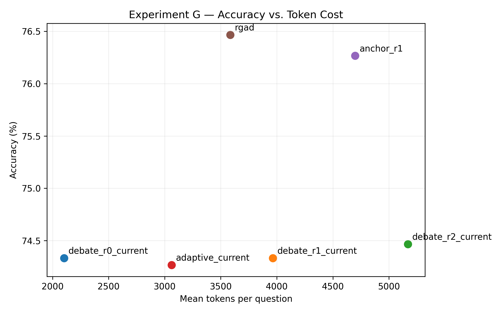

# Adaptive and Risk-Aware Interaction for Multi-Agent LLM Reasoning

Research project investigating **when LLM agents should interact, when they should stop, and how adaptive routing can reduce computational cost and harmful error propagation**.

<p align="center">
  
</p>

## Research Question

> When should an LLM system use additional interaction, and when should it stop, in order to improve reasoning without unnecessary computational cost or added failure risk?

## Setup

- **Model:** Qwen2.5-7B-Instruct
- **Benchmark:** MATH
- **Infrastructure:** Compute Canada / NVIDIA A100
- **Evaluation:** semantic answer verification with `math-verify`
- **Protocols studied:** Self-Refine, Student–Critic, Agent Forest, Multi-Agent Debate

## Main Findings

The experiments show that additional interaction is **not monotonically beneficial**.

- Most accuracy gains occur in the first interaction rounds.
- Later rounds can increase token cost without improving performance.
- Additional interaction can also introduce `correct → wrong` transitions.
- In Debate, agents can converge to an incorrect answer after one agent initially had the correct solution.
- Semantic answer stability is a useful signal for deciding when additional reasoning is unnecessary.

Adaptive Self-Refine achieved approximately:

| Strategy | Accuracy | Tokens / question |
|---|---:|---:|
| R1 | 78.20% | 2,696 |
| R2 | 78.33% | 4,428 |
| R3 | 78.33% | 6,116 |
| **Adaptive** | **78.73%** | **3,244** |

Adaptive stopping used about **27% fewer tokens than R2** and **47% fewer than R3** while maintaining comparable accuracy.

## Current Method: Risk-Aware Adaptive Routing

The final research direction models both the expected benefit and risk of another interaction round.

At interaction state \(s_r\), the router estimates:

\[
P(\text{help}\mid s_r)
\]

and

\[
P(\text{harm}\mid s_r),
\]

where `help` represents a `wrong → correct` transition and `harm` represents a `correct → wrong` transition.

The system continues interaction only when predicted benefit sufficiently exceeds predicted risk.

Runtime signals include:

- agent disagreement;
- answer stability;
- newly formed consensus;
- answer changes between rounds;
- peer-answer adoption;
- interaction depth.

The routing policy does **not** use ground-truth answers or benchmark difficulty at inference time.

## Repository Structure

```text
experiments/   # experimental code
slurm/         # HPC execution scripts
results/
  figures/     # selected figures
  summary/     # compact experimental summaries
docs/          # research material
```

Large model checkpoints, raw datasets, logs, and full experimental traces are intentionally excluded.

## Research Context

Research developed during my academic exchange at **Polytechnique Montréal**, in a research environment connected to **GERAD — Group for Research in Decision Analysis**.

GERAD research: https://www.gerad.ca/en/research

## Status

The project is currently focused on:

- validation of the final risk-aware router;
- generalization to additional benchmarks/models;
- consolidation of results for publication.
